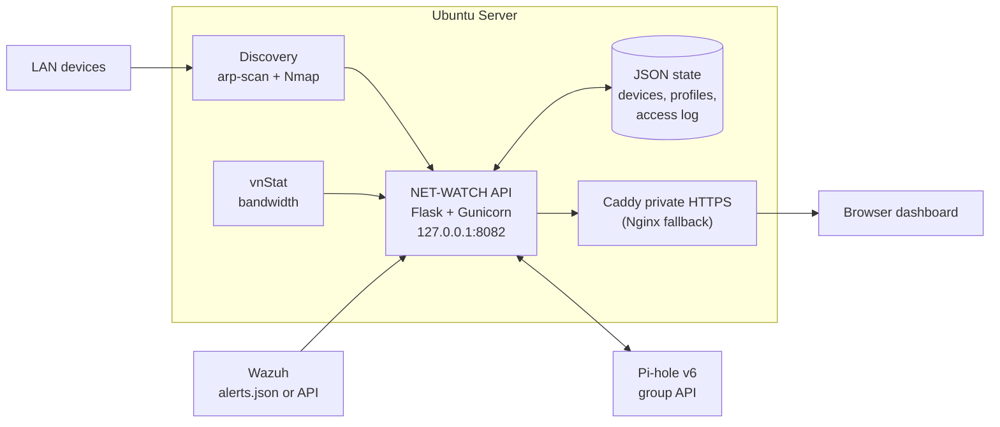
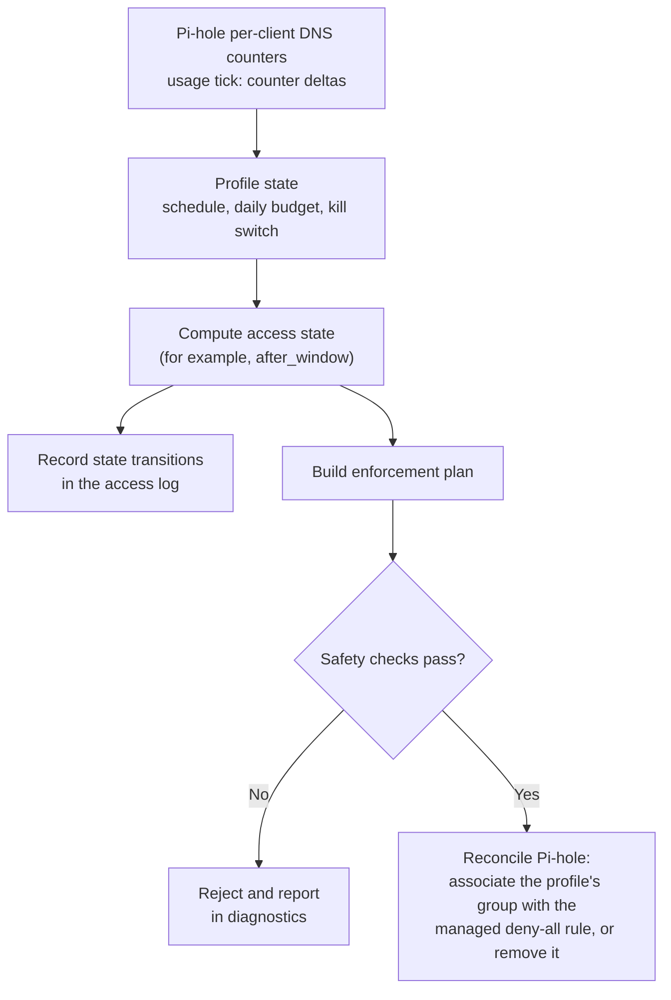

# NET-WATCH Architecture

NET-WATCH is a Flask API and single-page dashboard that combines network discovery, per-profile access policy and security visibility. It runs as a hardened systemd service behind a private reverse proxy. This document describes how the pieces fit together; installation and operation are in the [README](README.md).

## System context

| Component | Technology | Responsibility |
|---|---|---|
| Discovery | arp-scan, Nmap | Finds devices on each configured subnet and enriches them (MAC vendor lookup, automatic naming) |
| Bandwidth | vnStat | 24-hour and daily bandwidth, per-client views |
| API | Python 3, Flask, Gunicorn | Device and profile management, scheduling, usage accounting, enforcement and the data feeds for the dashboard |
| State | JSON files in `config/` | `devices.json`, `profiles.json` and the persisted access log, written atomically |
| DNS policy | Pi-hole v6 REST API | Profile-scoped group enforcement |
| Security visibility | Wazuh | Alert severity, rule details, agent context and MITRE ATT&CK mappings |
| Frontend | HTML, CSS, JavaScript, Chart.js | Single-page dashboard served from `web/index.html` |
| Proxy | Caddy (validated), Nginx (fallback) | Private HTTPS in front of the localhost-only API |

## API surface

| Area | Endpoints |
|---|---|
| Health and auth | `GET /api/health`, `auth/login`, `auth/logout`, `auth/status` (optional authentication) |
| Devices | `GET/POST /api/devices`, `GET/PATCH/DELETE /api/devices/<id>` |
| Profiles | `GET/POST /api/profiles`, `PATCH/DELETE /api/profiles/<id>`, `POST .../killswitch` |
| Usage and access | `POST .../usage/tick`, `POST .../usage/reset`, `GET .../access`, `GET /api/access-log` |
| Network data | `GET /api/traffic`, `GET /api/bandwidth/clients`, `GET /api/dns/stats` |
| Security data | `GET /api/alerts/wazuh`, `GET /api/alerts/counts` |
| Enforcement diagnostics | `GET /api/pihole/enforcement`, `POST /api/pihole/enforcement/reconcile` |

## Access-control model

Each profile has a schedule, a daily budget and a kill switch. The API turns that state into a Pi-hole policy and keeps Pi-hole reconciled with it.

**Pi-hole safety model.** NET-WATCH never disables Pi-hole globally. One managed deny-all expression and an empty safety group named `NETWATCH-Control` are used. To block a profile, only that profile's Pi-hole group is associated with the managed rule, so other profiles and normal ad blocking stay active.

The reconciliation layer rejects unsafe configurations:

- the Pi-hole default group;
- missing or disabled profile groups;
- a control group containing clients;
- foreign rules or control groups;
- ambiguous group ownership.

**Usage accounting.** Daily budgets are based on per-client Pi-hole DNS counter deltas, not on whether a device is online. A minute counts only when assigned devices produce at least `USAGE_MIN_DNS_QUERIES_PER_TICK` new queries during a usage tick. DNS activity is an activity proxy, not literal screen time.

## Deployment and hardening

| Aspect | Detail |
|---|---|
| Service | `netwatch.service` runs Gunicorn (1 worker, 8 threads) bound to `127.0.0.1:8082` |
| Startup | systemd, ordered after `network-online.target`, `Restart=always` |
| Privileges | Runs as root because `arp-scan` needs raw sockets (the unit notes a `cap_net_raw` alternative); the unit applies filesystem and kernel hardening controls |
| Configuration | Root-managed `/etc/netwatch/netwatch.env`. Secrets never live in the repository |
| Exposure | The API listens on localhost only. Reach it through the reverse proxy |
| Installer | `setup.sh` installs prerequisites, creates a virtualenv, deploys to `/opt/netwatch`, installs the service, integrates with an active Caddy or configures Nginx, and applies the local firewall rule |
| Upgrades | Re-running the installer preserves configuration and profile data. Back up before upgrading |

## Limitations

- A single Pi-hole instance is a DNS availability dependency. Resilient filtering needs a second independent Pi-hole host.
- Multi-VLAN discovery needs a valid interface and route on the server for each scanned network.
- Authentication should be enabled before the dashboard is reachable from less-trusted segments.
- DNS-based accounting approximates activity rather than measuring screen time. Richer bandwidth attribution and deeper Wazuh vulnerability data are listed as future work in the README.

## Related documents

- [README](README.md)
- [Incident reports](INCIDENT_REPORTS.md)
- [Security policy](SECURITY.md)
- [COC Phase 6: NET-WATCH](https://github.com/scott-renny/cyber-operations-center-engineering-program/tree/main/phases/phase-06-netwatch)
